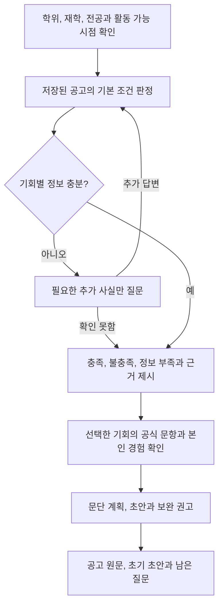

# BenefitLens 팀 구성과 검증 프레임워크

2026-11-19. 리더별 저장소 조사와 Ubuntu Claude CLI 3회 토의를 반영한 설계안이다. 새 조직과 계약의 운영 연결은 제안 상태다. 기존 Python 수집 서비스 4개는 계속 실행한다.

## 해결할 문제와 발표 프레이밍

**학생이 자기 조건에 맞는 지원기회를 확인하고, 본인의 경험을 실제 문항에 맞는 신청서로 준비하는 반복 비용을 줄인다.** 장학금, 유급 인턴, 참여수당과 경진상금 등을 지원기회라는 상위 범위에서 다루되, 자격과 지급 조건은 유형별로 보존한다.

발표는 다음 질문으로 연결한다. “나에게 가능한 기회는 무엇인가?” → “자격을 확인하려면 무엇을 더 알아야 하는가?” → “이 문항에는 내 경험 중 무엇을 어떻게 써야 하는가?” 이 세 단계를 공고 정규화, 추가 질문, 근거에 연결된 작성 계획으로 해결한다.

미국 NCES의 2018 보고서는 2009년 고교 9학년 코호트의 2013년 학생 또는 부모 응답을 분석했다. 고교 졸업 코호트 중 FAFSA 미작성 응답자의 32%는 자격이 안 될 것 같아서, 23%는 작성 방법에 관한 정보 부족, 9%는 작업량과 시간 부담을 이유로 들었다. 복수응답이며 실제 적격성을 확인한 비율은 아니다. 한국 대학원생의 미신청률은 별도로 조사해야 한다. [원문, 본문 6쪽과 그림 4](https://files.eric.ed.gov/fulltext/ED590789.pdf)

Bettinger 등의 FAFSA 실험은 정보와 서류작성 도움의 가치를 뒷받침한다. 저자 공개 2012년 1월 원고 Table III의 부양학생 표본 868명에서 도움 제공의 제출 효과는 +15.7%p였다. 도움은 세금 정보 활용과 양식 작성 지원이며, 에세이 생성 실험이 아니다. [저자 원고](https://btl.scholars.harvard.edu/sites/g/files/omnuum11226/files/btl/files/bettinger_et_al_2012_role_of_application_assistance_and_info.pdf)

정보 자체의 효과도 조건에 따라 존재한다. SNAP 미가입 추정 적격 고령자 3만 명 실험의 9개월 등록률은 대조 6%, 정보 11%, 정보와 도움 18%였다. 따라서 발견과 신청 준비를 각각 평가한다. [Finkelstein와 Notowidigdo, 2019](https://doi.org/10.1093/qje/qjz013)

## 기존 방식의 한계와 현재 관찰

학습 비용과 준수 비용을 구분하는 행정부담 틀을 문제 분석에 사용한다. 지원기회의 존재를 알아내고 조건을 이해하는 일, 필요한 사실과 문서를 준비하는 일을 나눠 본다. 이 틀 자체가 우리 학생 집단의 부담을 측정한 결과는 아니다. [Moynihan, Herd, Harvey, 2015](https://doi.org/10.1093/jopart/muu009)

범용 LLM도 검색과 초안 작성을 할 수 있다. 우리의 검증 대상은 의미가 보존된 조건, 변경 이력, 문항과 개인 사실의 연결이 판정 오류와 준비 시간을 얼마나 줄이는가다. 원문 검색과 일반 LLM을 비교군으로 두고 구축 비용도 기록한다.

20:51 KST 상태에서 공고 36,856건은 발견 후보, 경험 29,706건은 중복 등을 제외한 기계 집계다. 경험 5만 건에는 아직 도달하지 않았다. Q&A 360,256건과 신규 작성 후보 24,383건은 별도 코퍼스다. 전체 후보의 의미 정규화, 전량 경험 분해와 완성 초안 효과 측정은 남아 있다.

## 총괄과 여섯 실행팀

총괄 리더 아래 콘텐츠실은 근거 장부, 문제 서사, 사용자 요구와 제품 범위를 관리한다. 외부 발표의 사실과 인과 주장은 독립 평가팀이 감사한다. 아래의 하위 직무는 책임 구분이며 한 사람이 겸임할 수 있다. 자신이 만든 산출물의 최종 평가와 승인은 다른 담당자가 맡는다.

| 팀 리더 | 하위 직무 | 소유하는 산출물과 완료 기준 |
| --- | --- | --- |
| 1. 공고와 의미 정규화 | 원천 갱신, 의미 사전, 정본과 질의 | 공통 필드, 조건 트리, 특화 확장, 공식 문항과 갱신 정책. 단위, 시점, 예외와 원문을 대조하고 새 표현의 승인 또는 보류 이유를 남긴다. |
| 2. 경험 구조화 | 사례 정리, 사건 분해, 의미 관찰 | 인물과 프로그램 및 회차별 사건, 자료 역할, 문항 의도 관찰. 사실, 지원자 전략과 분석자의 해석을 구별하고 각각의 근거를 연결한다. |
| 3. 좋은 글 기준 | 규범 자료, 장르별 구성, 패턴과 템플릿 | 출처가 있는 작성 기준과 문단 구조. 공식 요구, 일반 품질, 장르 관행과 사용자 선호를 층별로 정의한다. |
| 4. 개인화와 작성 실행 | 조건 판정, 사실과 추가 질문, 문단 계획과 작성 | 조건별 판정 근거, 부족 정보, 확인된 본인 사실과 초안. 단일 조건 엔진을 사용하고 사실과 문항 제약을 검사한다. |
| 5. 독립 평가와 품질관리 | 평가 자료, 독립 심사, 회귀와 보정 | 별도 정답셋, 평가자 일치, 오류와 수정 시간, 정책 검증 및 출시 판정. 생산팀이 만든 답을 그대로 정답으로 사용하지 않는다. |
| 6. 파이프라인 운영 | 실행과 갱신, 계보와 계약, 서비스 신뢰성 | 단계별 작업, 체크포인트, 스냅샷, 변경 영향과 복구. 내용팀이 선언한 정책을 실행하고 승인된 버전을 배포한다. |

항목별 의미 검토는 내용팀이 검증된 정책 범위에서 소유한다. 평가팀은 새 규칙, 자동승인 범위, 위험층 표본과 회귀를 검증한다. 새 표현이나 예외, 출처 충돌과 기준일 누락은 의미 검토 큐로 보낸다. 검증된 조합은 자동 처리하되 다른 절의 예외와 참조 조건까지 확인한다.

## 표현과 저장 및 인계 기준

### 공고: 뜻을 먼저 정의한다

공통과 특화는 의미와 사용 범위의 구분이다. 조회와 관계 키는 SQL 열로 두고, 공통 조건 트리와 특화 조건도 PostgreSQL JSONB에 저장할 수 있다. 특화 확장은 타입, 단위와 근거를 갖는다. 새 저장 엔진 도입은 이번 조직 개편의 전제 조건이 아니다.

현재 예제 계약의 category 4개 값과 인턴, 수당, 상금을 포함하는 확장 계약의 버전 관계를 공고팀이 먼저 정리한다.

정규형은 대상, 속성, 연산자, 값, 단위, 적용 시점, AND/OR/NOT, 예외와 출처를 보존한다. 임베딩은 동치 후보를 찾는 데 사용하고 판정 동치는 이 구조와 원문 문맥으로 결정한다.

- “600만원/학기”는 금액 6,000,000원과 학기당 지급을 저장한다. 총액으로 바꾸려면 지급 학기 근거가 더 필요하다.
- “최대 4학기”는 지원 기간의 상한이다. 금액 상한으로 매핑하지 않는다.
- “수혜 시작 전 대부분의 교과 이수”는 현재 완전 수료와 다른 조건이다. 현재 시점과 수혜 시작 시점을 구분한다.

공식 문항의 원문, 분량과 명시 기준은 공고팀의 `task_spec`을 정본으로 삼는다. 의미 관찰은 해당 버전과 원문 구간을 참조하며, 관찰자의 해석으로 공식 필수 요건을 추가하지 않는다.

### 경험: 사건과 작성 방식을 분리한다

사례는 프로그램, 인물과 회차에 문서를 연결한다. 사건의 선택 필드는 기회, 선택 이유, 본인 역할과 행동, 장애와 선택, 결과와 근거, 성찰, 향후 활용이다. 관찰되지 않은 필드는 비워 둔다. 연재 글 여러 개는 같은 사건에 연결할 수 있다.

문항의 의미 관찰에는 독자가 확인하려는 것, 요구 증거, 사용 목적, 시점, 명시 요구인지 공식 안내인지 해석인지와 대안을 기록한다. 같은 리더십 축이어도 선발 문항과 참여 후기 문항의 용도는 보존한다. 합격과 탈락은 확인 수준이 붙은 결과 맥락이며, 어떤 문장이 합격을 일으켰다는 라벨로 쓰지 않는다.

공개 타인 사례는 구성 선택과 추가 질문의 참고다. 사용자 초안의 사실은 사용자가 제공하거나 확인한 자신의 경험에 연결한다.

### 작성 기준: 세 층과 문단 계획

공통 품질은 문항에 답하기, 본인 기여, 관련 근거, 행동과 결과의 의미, 문단 통일성, 문단 사이 연결과 명확성이다. 연구계획, 경험 에세이 등 장르별로 필요한 구성을 덧붙인다. 공식 분량과 형식은 별도 필수 검사다.

교재 원천으로는 동료 심사를 거친 공개 글쓰기 교재 [Writing Spaces](https://wacclearinghouse.org/books/writingspaces/)를 포함한다. 로컬 해당 수집 묶음은 장 후보 51개, 본문 확보 0개 상태이므로 규범팀의 확보와 검토 과제다. 이미 정의한 원칙 8개와 기준 9개에는 각 출처와 적용 범위를 유지한다.

Harvard의 문단 안내는 요점, 근거와 해석의 관계를 설명하고, 전환 안내는 앞뒤 생각의 실제 관계를 드러내도록 권한다. 이를 문단 목적과 연결 기준의 근거로 사용한다. [문단 안내](https://writingcenter.fas.harvard.edu/anatomy-body-paragraph), [전환 안내](https://writingcenter.fas.harvard.edu/transitions)

이 사용자의 초안에는 문단 순서, 첫 문장의 역할, 끝 문장의 도달점과 다음 문단 연결을 명시하는 스타일 프로필을 적용한다. 각 문단 계획은 `목적 / 주장 / 개인 근거 ID / 첫 문장 기능 / 끝 문장 기능 / 이웃 문단과의 관계`를 갖는다. 공식 문항이 단문을 요구하면 그 범위에 맞춘다.

### 공통 인계 단위

공통 실행 프레임워크는 데이터 계약, 상태 전이, 의존성 DAG와 평가 게이트로 구성한다. 기존 Python 실행기와 체크포인트를 재사용하고, 각 단계는 버전이 있는 입력과 산출물로 연결한다.

`원문 스냅샷 → 공고 버전과 공식 문항 → 근거가 있는 조건`

`경험 사례 → 사건 사실과 의미 관찰 → 검토된 기준과 구성 후보`

`사용자 확인 사실 + 조건과 문항 → 판정 이력과 추가 질문 → 문단 계획 → 초안과 기준별 검토`

각 결과는 입력 문서, 스키마, 의미 정책과 모델 버전, 검토 결정에 연결한다. 1팀과 4팀은 어떤 변경이 판정과 초안에 영향을 주는지 선언하고, 6팀은 그 의존성을 따라 갱신하거나 보류한다.

## 사용자 흐름과 운영 주기

성적과 재학 문서에서 직접 읽은 값, 규칙으로 계산한 값, 의미 추론과 사용자 확인을 구분한다. 학점만으로 수료 여부나 향후 참여 가능성을 확정하지 않는다. 현재의 “예측” 팀은 조건 판정과 작성 실행을 뜻한다.

공고 갱신의 초기 정책 후보는 기본 24시간, 마감 72시간 이내 6시간, 비활성 자료 7일이다. 선착순, 예산 소진형과 변경 알림 원천은 별도로 조정한다. 이는 최적 주기를 측정한 결과가 아니다. 2~4주간 의미 변경률, 탐지 지연, 헛조회와 재검토 비용을 보고 조정한다. 정책은 공고팀, 실행은 운영팀이 맡는다.

모집 상태, 자료의 최신성, 사용자 자격은 각각 관리한다. 네트워크 실패는 최신성의 재확인 필요 상태로 기록한다. 공고 마감이나 사용자 불충족으로 바꾸지 않는다. 과거 확인 스냅샷은 보존한다.

## 평가와 현재 범위

비교군 A는 원문 검색과 일반 LLM, B는 정규화 DB와 일반 작성 지침, C는 B에 경험과 의도 기반 계획을 더한 방식이다. 동일 프로필, 문항, 사용자 사실, 모델과 온라인 예산을 사용한다. 수집, 사람 검토와 갱신 비용도 보고한다. C의 효과를 경험과 계획 각각의 효과로 나누려면 별도 절제 실험을 한다.

| 검증할 주장 | 측정과 통제 |
| --- | --- |
| 의미 정규화가 판정 오류를 줄인다 | 원문 근거가 있는 조건 정답셋, 시점과 단위 및 예외 오류, 정보 부족 오판, 고정 원천 범위의 발견 재현율 |
| 추가 질문이 입력 부담을 줄인다 | 질문 수, 입력 시간과 완료율을 정보 부족 오판 및 누락과 함께 측정 |
| 작성 계획이 준비 품을 줄인다 | 사실 오류, 문항 누락, 눈가림 비교와 수정 시간. 길이와 장르를 통제 |
| 갱신 정책이 최신성을 유지한다 | 의미 변경 탐지 지연, 오래된 조건으로 내린 판정, 조회와 재검토 비용 |

기존 9개 기준의 0/1/2점은 미보정 진단값이다. 파일럿에서 근거와 의견 차이를 수집하고 평가자 간 일치를 확인한다. 임의 합계와 합격 확률로 바꾸지 않는다.

PERSUADE 10,402편과 ELLIPSE 6,482편은 303편이 겹치며 고유 글은 16,581편이다. 기존 PERSUADE test 분할은 이미 분석에 사용했으므로 개발과 보정 자료로 관리한다. 독립 평가는 새 실제 지원 문항과 사람 평가로 구축한다. 알려진 프로그램의 새 작성자와 미래 회차 평가, 미등록 프로그램 전이 평가를 나누고, 작성자와 텍스트 중복을 차단한다. 기관과 서식 계열 공유 여부도 기록한다.

구현된 것은 조건 트리와 3값 판정, 제한된 예제 인계, 수집과 원문 저장, 문항 10개의 미승인 의미 관찰, 미보정 작성 기준이다. 개인화 POST, 완성 초안 생성, 전체 데이터의 의미 승인과 전 구간 변경 전파는 추가 통합 대상이다. 현재 작성 인계 어댑터는 부족 질문과 슬롯을 반환하며 `draft_text=None`이다.

## Claude 토의 결과와 첫 산출물

Ubuntu Claude CLI에서 도구 접근 없이 3회 토의했다. 1차는 책임 중복과 주장 범위, 2차는 평가 독립성과 승인 병목, 3차는 자동화 범위와 평가 분할을 검토했다.

반영한 결정은 공식 요건과 해석의 분리, 기존 분석 자료의 개발용 분류, 내용팀의 항목 검토와 평가팀의 정책 감사 분리, 최신성과 자격의 분리다. 고위험 필드를 모두 수작업으로 재검토하는 안은 검증된 조합의 자동 처리와 애매한 항목의 보류로 수정했다. 역표현이나 동일 모델의 재검사는 검수 보조로 사용하고 정확도 입증은 독립 평가로 수행한다.

첫 산출물은 1팀의 공통 필드와 특화 확장 버전표, 2팀의 근거 포함 사건과 의미 관찰 예제, 3팀의 장르별 문단 템플릿, 4팀의 추가 질문과 문단 계획 예제, 5팀의 분리 평가셋과 기준표, 6팀의 단계별 의존성과 재개 명세다. 총괄은 이 여섯 인계물을 같은 프로그램과 사용자 예제로 연결한다.

남은 인과 공백은 우리 대상 학생의 실제 탐색과 작성 부담, 초안 지원이 수정 시간과 실제 신청에 미치는 효과다. 최초 사용자 조사와 비교 실험으로 채워야 한다. 이번에 정한 것은 그 검증을 수행할 책임과 계약이다.
